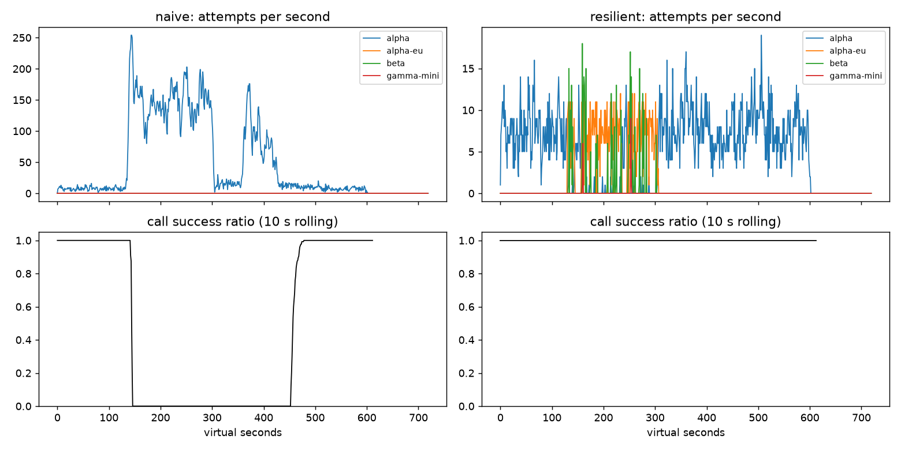

# Lab 25B — Báo cáo Game Day

**Họ tên:** Bui Tien Cuong  
**MSV:** 2A202602539  
**Commit:** 0f89fa148b437295c17f54826ff2747b4f12f0ad  
**Điểm tự động công khai:** 84/88

## 1. Kết quả Game Day

| Băng | Client | Availability | p95 (s) | Amplification | Retry ratio | Cost/turn | Recovery (s) | Đạt? |
|---|---|---:|---:|---:|---:|---:|---:|:---:|
| G1 | naive | 0,7194 | 7,157 | 7,738 | 6,738 | 2,163 | 4 | Không |
| G1 | resilient | 1,0000 | 4,817 | 1,060 | 0,001 | 2,094 | 0 | Có |
| G2 | naive | 0,4560 | 15,034 | 9,904 | 8,904 | 4,627 | 155 | Không |
| G2 | resilient | 1,0000 | 10,023 | 1,035 | 0,005 | 2,107 | 0 | Có |
| G3 | naive | 1,0000 | 4,768 | 1,164 | 0,164 | 2,328 | 0 | Không |
| G3 | resilient | 1,0000 | 4,642 | 1,076 | 0,049 | 2,167 | 0 | Có |
| G4 | naive | 1,0000 | 13,764 | 1,004 | 0,004 | 2,008 | 0 | Không |
| G4 | resilient | 1,0000 | 5,626 | 1,014 | 0,002 | 2,072 | 0 | Có |
| G5 | naive | 0,3699 | 5,359 | 17,030 | 16,030 | 2,124 | — | Không |
| G5 | resilient | 0,8179 | 5,482 | 1,003 | 0,002 | 2,504 | — | Có |
| G6 | naive | 0,5170 | 4,836 | 12,344 | 11,344 | 2,009 | 0 | Không |
| G6 | resilient | 1,0000 | 6,096 | 1,059 | 0,023 | 2,188 | 0 | Có |

`—` là metric không xác định trong JSON của G5. Trên G2, bản mới giảm amplification từ 9,904 xuống 1,035. Trên G5, availability tăng từ 36,99% lên 81,79%. Cả sáu băng đều pass ở ba seed công khai.

## 2. Cấu hình client và quyết định xử lý lỗi

| Tham số | Giá trị | Cơ sở từ kết quả |
|---|---:|---|
| `attempt_timeout_s` | 8 s | G6 đạt availability 100%; thử 30 s chỉ đạt 94,88%, với 103 lần bỏ cuộc do deadline. |
| `max_attempts_per_provider` | 2 | Giới hạn retry cùng provider; G3 retry ratio 0,049, dưới ngưỡng 0,10. |
| `backoff_base_s / cap_s` | 0,25 / 4 s | Full jitter phân tán retry; G2 amplification 1,035 so với 9,904 của naive. Kết quả còn phụ thuộc breaker và budget. |
| `retry_budget_ratio` | 0,10 | Khi vô hiệu breaker trên G2, budget giảm retry ratio từ 0,397 xuống 0,058 so với trường hợp tắt budget. |
| `breaker.window_size / min_calls` | 20 / 10 | Chỉ xét tỷ lệ khi có ít nhất 10 kết quả; G2 recovery 0 s và G3 availability 100%. |
| `breaker.failure_rate_threshold` | 0,50 | Mở mạch khi lỗi dày; G2 amplification 1,035, primary share sau hồi phục 1,000. |
| `breaker.slow_call_s` | 5 s | Phát hiện vùng chậm dù không trả lỗi; G4 p95 từ 13,764 xuống 5,626 s. `slow_rate_threshold = 0,60`. |
| `breaker.open_duration_s` | 10 s | Sau thời gian mở, thăm dò provider; G2 recovery 0 s và primary share 1,000. |
| `breaker.half_open_max_probes` | 2 | Giới hạn thăm dò đồng thời; G2 amplification 1,035, không tạo làn sóng retry khi phục hồi. |

Các metric phản ánh **toàn bộ client**, không đo riêng tác dụng nhân quả của từng tham số. `on_error` quyết định như sau:

| Lỗi | Breaker | Retry | Failover/cooldown |
|---|---|---|---|
| 400, lỗi client | `release` | Không | Bỏ cuộc; không chuyển request sai. |
| 429 hết quota | `release` | Không | Cooldown 300 s, chuyển provider. |
| 429 rate limit | `release` | Không | Cooldown theo `retry-after`, chuyển provider; nếu hết lựa chọn có thể chờ tối đa 5 s. |
| 529/503, 5xx, timeout | Ghi lỗi | Chỉ khi còn attempt, budget và deadline; full jitter | Nếu không retry được, chuyển provider tương thích. |

Client chỉ có một tầng retry. `ladder()` loại model không hỗ trợ tool khỏi call `tool`. G5 có `client_error_retries = 0`, `unneeded_failovers = 0`; G6 có `incompatible_routes = 0`.

## 3. Ba thí nghiệm

1. **Retry budget khi breaker cấu hình sai.** Đặt `breaker.min_calls = 1.000.000.000`, `max_attempts_per_provider = 5`. Trên G2, giữ budget cho amplification **1,380**, retry ratio **0,058**, recovery **0 s**; tắt budget cho **1,602**, **0,397**, **29 s**. Trên G3, hai cấu hình lần lượt cho amplification **1,136/1,164**, retry ratio **0,068/0,163**, recovery đều **0 s**. Khi breaker hoạt động bình thường, G2 có amplification **1,035** và retry ratio **0,005**; budget vẫn là giới hạn cuối khi breaker thiếu mẫu hoặc cấu hình sai.

2. **Timeout 30 s.** Trên G6, tăng timeout từ 8 lên 30 s làm availability giảm từ **1,0000** xuống **0,9488**; `give_up_reasons` từ `{}` thành **103 `deadline` và 19 `no_provider_available`**. p95 của *lượt thành công* lại giảm từ **6,096** xuống **5,463 s**, vì các lượt treo rồi thất bại không nằm trong mẫu p95. Trên G4, availability vẫn **1,0000**, p95 gần như không đổi (**5,626** so với **5,608 s**) do provider vẫn trả lời trước deadline. Timeout cần xét p99 bình thường, deadline 30 s của user và thời gian còn đủ để chuyển provider.

3. **Bỏ lọc khả năng gọi tool.** Trên G6, bản có lọc đạt availability **1,0000**, `incompatible_routes = 0`; bản thí nghiệm không lọc còn **0,9036** và có **230** đường đi không tương thích. Với người dùng sản phẩm, đó là 230 lần hệ thống đưa bước cần thao tác hoàn tiền cho model không thể gọi công cụ; luồng xử lý bị hỏng dù model có thể trả lời văn bản.

Metric và cấu hình thử nằm trong `reports/experiments/*.json`; script tái tạo là `scripts/run_report_experiments.py`.

## 4. Workflow hoàn tiền

| Executor | Completion | Crashes | Refund trùng | Email trùng | Refund mất | Trả dư (cent) | LLM lãng phí/crash |
|---|---:|---:|---:|---:|---:|---:|---:|
| naive | 100% | 81 | 128 | 81 | 0 | 1.496.700 | 1,123 |
| ours | 100% | 66 | 0 | 0 | 0 | 0 | 0,303 |

Idempotency key ổn định ngăn payment và email thực thi trùng khi response mất hoặc worker chết sau side effect. Chỉ có key vẫn chạy lại các bước LLM đã hoàn tất và tốn thêm chi phí; checkpoint giúp resume. Chỉ có checkpoint vẫn tồn tại khoảng trống giữa **side effect đã chạy** và **checkpoint chưa lưu**, khiến worker mới có thể thực thi lần nữa. Nếu ghi checkpoint *trước* payment, crash ở khoảng giữa khiến lần resume bỏ qua bước chưa hoàn tiền. Với 500 session, bản mới không trùng, không mất refund và đạt giới hạn lãng phí ≤ 0,6.

## 5. Alerting và error budget

| Sự cố | Mong đợi | Naive alerter | Burn-rate alerter | Trễ phát hiện của burn-rate |
|---|---|---|---|---:|
| `checkout_bug` | page | page, 1 phút | page | 27 phút |
| `provider_outage` | page | page, 0 phút | page | 4 phút |
| `deploy_blip` | không alert | page sai | không alert | — |
| `slow_leak` | ticket | bỏ sót | ticket | 1.337 phút |
| `degraded_evening` | page | page, 214 phút | page | 291 phút |
| `night_spike` | không alert | page sai | không alert | — |
| `small_bump` | không alert | page sai | không alert | — |

Trong 30 ngày có **25.901.755** request, SLO 99,5% cho phép khoảng **129.508,8** lỗi; thực tế có **55.618** lỗi. Budget đã tiêu **42,95%**, còn **57,05%** (`availability = 99,7853%`), nên `freeze_releases = false`. `small_bump` kéo dài 20 phút với 12% lỗi nhưng không duy trì đủ burn rate đồng thời trên cửa sổ ngắn và dài. Chỉ page theo cửa sổ 5 phút gây nhiễu: naive có 3 false page.

## 6. Postmortem G2 — client naive

**Tóm tắt.** Ở giây 120, `alpha` mất 75% năng lực và bản naive tiếp tục retry qua ba tầng. Lượng attempt lớn duy trì hàng đợi quá tải sau khi provider trở lại ở giây 300. Sự cố xuất phát từ thiết kế retry và thiếu điều tiết, không quy trách nhiệm cho cá nhân.

**Ảnh hưởng.** Trong **2.362** lượt user, **1.285** lượt thất bại (`availability = 45,60%`); p95 của lượt thành công là **15,034 s**. `recovery_s = 155` cho biết sự phục hồi trễ 155 giây so với mốc provider trở lại, theo định nghĩa metric của simulator. Để quy đổi sang tháng, giả định lưu lượng nền **4 lượt/s liên tục trong 30 ngày** và tháng chỉ có sự cố này: **10.368.000** lượt, budget lỗi 0,5% bằng **51.840** lượt; 1.285 lỗi tiêu khoảng **2,48% budget tháng**. Trong riêng băng 2.362 lượt, mức lỗi cho phép là **11,81** lượt; số lỗi quan sát cao gấp khoảng **108,8 lần** tỷ lệ SLO cho phép.

**Timeline.** Các số `attempts_alpha` và call thành công/hoàn tất lấy từ `reports/gameday/naive_G2_overload_storm_timeseries.csv`; tỷ lệ 10 giây tính cùng cách với biểu đồ của lab.

| Giây ảo | Diễn biến | Bằng chứng |
|---:|---|---|
| 110 | Trước sự cố | `alpha`: 5 attempt/s; 9/9 call thành công; tỷ lệ 10 s = 100%. |
| 120 | Bắt đầu mất 75% năng lực | `alpha`: 5 attempt/s; 7/7 call thành công; tác động chưa hiện ngay ở kết quả. |
| 150 | Retry storm hình thành | `alpha`: 163 attempt/s; 0/3 call thành công; tỷ lệ 10 s = 0%. |
| 250 | Quá tải kéo dài | `alpha`: 184 attempt/s; 0/6 call thành công; tỷ lệ 10 s = 0%. |
| 300 | Provider khôi phục năng lực | `alpha`: 115 attempt/s; 0/5 call thành công; tỷ lệ 10 s = 0%. |
| 400 | Hệ thống chưa hồi phục | `alpha`: 51 attempt/s; 0/5 call thành công; tỷ lệ 10 s = 0%. |
| 455 | Kết quả bắt đầu cải thiện | `alpha`: 13 attempt/s; 4/5 call thành công trong giây này; tỷ lệ 10 s = 30%. |
| 500 | Sau giai đoạn phục hồi | `alpha`: 9 attempt/s; 10/10 call thành công; tỷ lệ 10 s = 100%. |

**Trigger và nguyên nhân gốc.** Trigger là mất năng lực GPU của `alpha` từ giây 120 đến 300. Nguyên nhân gốc là retry ba tầng với delay cố định, không có budget hoặc breaker: lỗi và timeout tạo thêm request, lấp hàng đợi và tiếp tục gây timeout. Request client đã bỏ vẫn được server xử lý. Vì vậy sau giây 300 provider dùng công suất cho công việc không còn hữu ích; vòng lặp duy trì thất bại thêm **155 giây**.

**Điều giúp và điều làm tệ hơn.** Năng lực provider trở lại và tải cuối cùng giảm, nhưng naive không chủ động giảm retry. Trên cùng băng, client mới đạt amplification **1,035** thay cho **9,904**, availability **100%** thay cho **45,60%**, recovery **0 s**. Kết quả này hỗ trợ breaker, budget và fallback như biện pháp cắt vòng lặp.

| # | Hành động | Loại | Owner theo vai trò | Cách kiểm chứng |
|---|---|---|---|---|
| 1 | Dùng đúng một tầng retry, full jitter và budget. | Prevent | Nhóm client | CI G2 amplification ≤ 1,6; G3 retry ratio ≤ 0,10 trên ba seed. |
| 2 | Theo dõi attempts/logical call, hàng đợi và lỗi theo provider; cảnh báo khi amplification > 1,6. | Detect | Nhóm SRE | Dashboard thể hiện storm, gồm mốc 150 với 163 attempt/s ở `alpha`; thử phát alert trên băng G2. |
| 3 | Breaker theo tỷ lệ lỗi/call chậm, giới hạn probe và chuyển provider tương thích. | Mitigate | Nhóm nền tảng LLM | G2 recovery ≤ 30 s, primary share sau phục hồi ≥ 80%; G6 `incompatible_routes = 0`. |

## 7. Điểm yếu còn lại

G2 vẫn có p95 **10,023 s** dù availability đạt 100%. Nếu nhiều provider cùng chậm, timeout và failover tuần tự có thể chiếm phần lớn deadline 30 s; băng hiện tại chưa kiểm tra việc cả bốn deployment cùng suy giảm. Cần đánh giá timeout theo phân vị latency bình thường và deadline còn lại, rồi chạy băng nhiều provider cùng chậm để đo availability, p95 và amplification trước khi đổi cấu hình.

## 8. Cache

| Client | Availability | FAQ availability | Hit ratio | Stale served | Wrong answers | Outdated answers | Cost/turn | Đạt? |
|---|---:|---:|---:|---:|---:|---:|---:|:---:|
| resilient, không cache | 0,8373 | 0,8424 | 0,000 | 0 | 0 | 0 | 1,386 | Không |
| cached | 0,9120 | 0,9640 | 0,652 | 156 | 0 | 3 | 0,916 | Có |

| Tham số cache | Giá trị | Cơ sở chọn |
|---|---:|---|
| `similarity_threshold` | 0,94 | Mức 0,80 gây **263** lỗi `other_question`; 0,94 cho 0 lỗi và hit ratio 0,652. Mức 0,97 cũng 0 lỗi nhưng hit ratio 0,583. |
| `ttl_s` | 60 s | TTL 300 s gây **95** câu trả lời lỗi thời, vượt giới hạn 15; 60 s còn **3** và hit ratio 0,652. |
| `max_stale_s` | 180 s | Có 156 câu được phục vụ stale khi provider lỗi, đưa FAQ availability lên 0,9640; đặt 0 s chỉ còn 0,8733. |

**Ngưỡng tương đồng.** Với 0,80 / 0,94 / 0,97, hit ratio lần lượt **0,670 / 0,652 / 0,583**, `wrong_answers` **263 / 0 / 0**, cost/turn **1,008 / 0,916 / 0,963**. Cả 263 lỗi ở 0,80 được simulator ghi là `other_question`: các câu có embedding gần nhau nhưng khác nội dung cần trả lời. Dữ liệu không nêu văn bản của từng cặp, nên không gán tên câu cụ thể. Mức 0,94 giữ 0 lỗi trên C1 và nhiều hit hơn 0,97.

**TTL.** Với 30 / 60 / 300 s, `outdated_answers` là **2 / 3 / 95**, hit ratio **0,591 / 0,652 / 0,731**, FAQ availability **0,9634 / 0,9640 / 0,9640**. Webhook chỉ vô hiệu hóa tài liệu **được báo** thay đổi; bảng phí đổi không báo trước nên TTL mới giới hạn tuổi câu trả lời cũ. TTL 60 s giữ lỗi thời dưới ngưỡng 15 với nhiều hit hơn TTL 30 s.

**Stale-if-error.** Khi `max_stale_s = 0`, FAQ availability giảm từ **0,9640** xuống **0,8733**, `stale_served` từ **156** xuống **0**; số lần bỏ cuộc `no_provider_available` tăng từ **247** lên **403**. Stale chỉ dùng khi provider không trả lời và entry còn trong cửa sổ; webhook vô hiệu hóa ngay entry dù nó chưa hết hạn.

Câu hỏi cá nhân phụ thuộc trạng thái đơn hàng, tiền và quyền truy cập tại thời điểm hỏi. Cache theo `user_id` vẫn có nguy cơ dùng dữ liệu cũ sau khi trạng thái hoặc quyền đã đổi, nên không cache loại câu hỏi này. Khi FAQ được phục vụ từ cache trong outage, on-call cần theo dõi lỗi/timeout và breaker của provider, tỷ lệ `stale_served`, cùng availability của call cần tool và FAQ cá nhân; availability tổng có thể che khuất sự cố.
